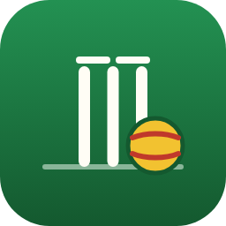
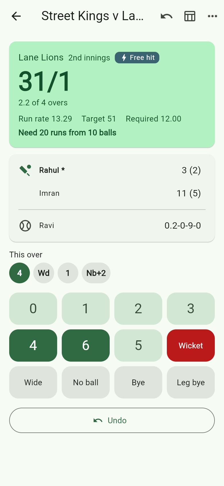
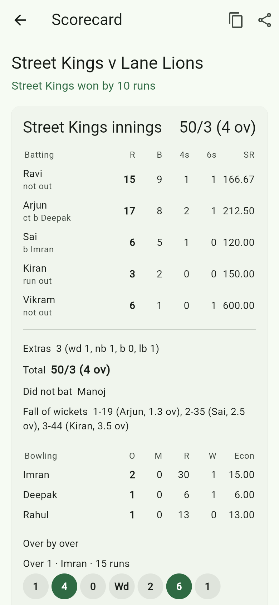
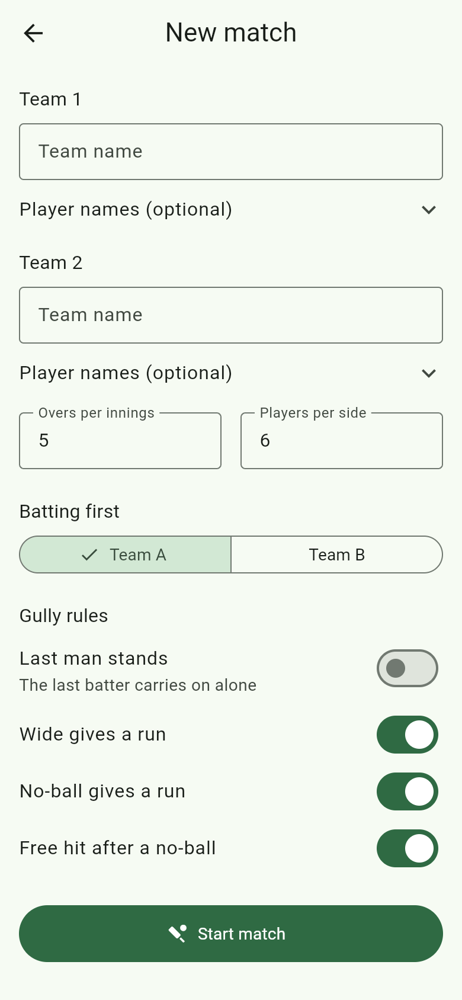
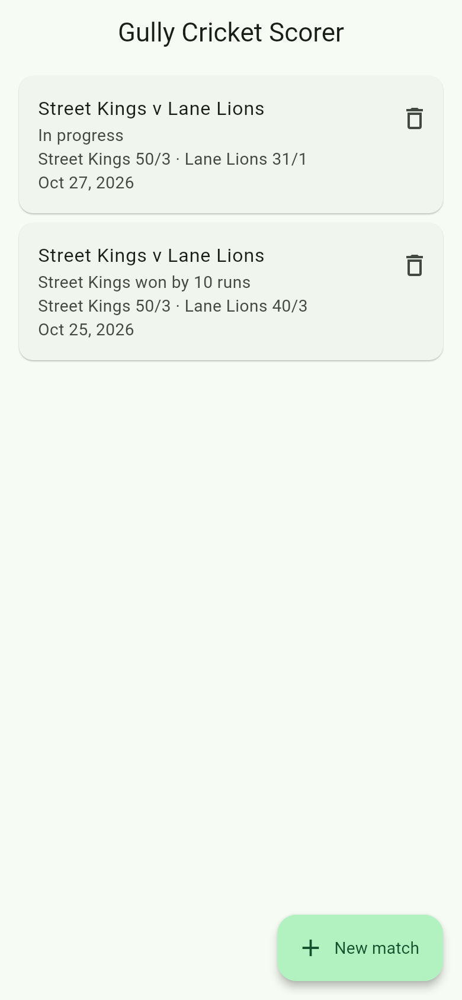

<p align="center">
  
</p>

<h1 align="center">Gully Cricket Scorer</h1>

<p align="center">
  Ball-by-ball scoring for street, school and weekend cricket.<br>
  Free, open source, works offline, and your matches never leave your phone.
</p>

<p align="center">
  <a href="https://github.com/ChandraChaan/gully-cricket-scorer/actions/workflows/ci.yml"></a>
  <a href="https://github.com/ChandraChaan/gully-cricket-scorer/actions/workflows/pages.yml"></a>
  <a href="LICENSE"></a>
  
  
</p>

<p align="center">
  <b><a href="https://chandrachaan.github.io/gully-cricket-scorer/">Open the live app</a></b>
  &nbsp;·&nbsp; install it from your browser menu ("Add to Home screen") and it works with no signal
</p>

<p align="center">
  
  
  
  
</p>

## Why

Scoring a gully match on paper goes wrong the moment someone asks "how many
balls left?" or a ball is recorded twice. Big scoring apps want an account,
a network connection and full cricket rules. This one is for the game you
actually play: 5 overs a side, 6 players, last man stands, and a wide that
may or may not be worth a run.

## Features

**Match setup**
- Two teams, any number of overs, 2 to 30 players a side
- Optional player names (one per line); blanks become "Player 1", "Player 2"…
- Gully rules you can switch: last man stands, wide = 0 or 1 run,
  no-ball = 0 or 1 run, free hit after a no-ball
- Choose who bats first

**Ball-by-ball scoring**
- Big buttons for 0–6, wide, no-ball (plus runs off the bat), byes, leg byes
- Wickets: bowled, caught, LBW, stumped, hit wicket, run out (either batter,
  with runs completed, off a fair ball, wide or no-ball) and retired
- Strike changes on odd runs and at the end of each over; swap by hand if needed
- Asks for the new bowler every over (not the previous over's bowler) and the
  next batter after every wicket
- Free hits: only a run out counts, and the free hit carries over a wide
- **Undo any number of balls**, all the way back to the toss
- Innings break with the target, required run rate and "need 20 from 10"
- Result: "won by 12 runs", "won by 3 wickets", or a tie, with an optional
  **super over** (the side that batted second bats first, 2 wickets)

**Scorecard**
- Batting: R, B, 4s, 6s, SR and how out
- Bowling: O, M, R, W, Econ
- Extras, total, did not bat, fall of wickets, over-by-over summary
- Share as WhatsApp-friendly text, or copy it

**Everywhere**
- Matches are saved after every ball, with a history list
- Installable web app (PWA) that works offline, plus an Android build
- Light and dark themes, large touch targets, screen-reader labels

## Privacy

Everything stays on your device. There is no account, no server, no
analytics and no ads. Matches are stored in your browser's local storage (or
the app's private storage on Android). The only network requests the web app
makes are for its own files and the Roboto font, so it can start offline later.
Clearing the site's data deletes your matches.

## How it works

The scoring engine is plain Dart with no Flutter imports, in
[`lib/features/match/domain`](lib/features/match/domain). A match is stored as
its setup plus a list of events:

```dart
InningsStarted(striker: 0, nonStriker: 1, bowler: 0)
BallBowled.runs(4)
BallBowled(kind: BallKind.wide, runs: 1)
BallBowled(kind: BallKind.legal, dismissal: Dismissal(HowOut.caught))
BatterChosen(2)
```

Every number on screen (score, strike, figures, maidens, fall of wickets,
whose turn it is to bowl, the result) is worked out by replaying those
events. That makes undo a matter of dropping the last event, makes saved
matches tiny, and makes the cricket rules easy to test: the engine has its
own suite of unit tests covering extras, strike changes, maidens, free hits,
last man stands, run outs at either end, early chase finishes, ties and super
overs.

The app around it follows the rules in
[flutter-agent-skills](https://github.com/ChandraChaan/flutter-agent-skills):
Riverpod 3, go_router, feature-first folders, strict analysis and
localised strings.

```
lib/
  core/                 router, sharing, clock, shared widgets
  features/
    match/
      domain/           pure-Dart engine: setup, events, derived state
      data/             shared_preferences storage
      presentation/     scoring screen, scorecard, controllers
    setup/              new match form
    history/            saved matches
  l10n/                 strings (app_en.arb)
```

## Run it

You need [Flutter](https://docs.flutter.dev/get-started/install) 3.44 or newer.

```bash
git clone https://github.com/ChandraChaan/gully-cricket-scorer.git
cd gully-cricket-scorer
flutter pub get
flutter run -d chrome
```

Checks that CI runs on every push:

```bash
dart format --output=none --set-exit-if-changed lib test
flutter analyze --fatal-infos
flutter test
```

## Contributing

Bug reports and ideas are welcome in
[Issues](https://github.com/ChandraChaan/gully-cricket-scorer/issues) and
[Discussions](https://github.com/ChandraChaan/gully-cricket-scorer/discussions).
If your street plays a rule this app doesn't handle (one-tip-one-hand,
no running behind, six-and-out), open an issue describing it. For a
change to the scoring rules, please add a test in
[`test/features/match/match_state_test.dart`](test/features/match/match_state_test.dart).

## License

[MIT](LICENSE)
